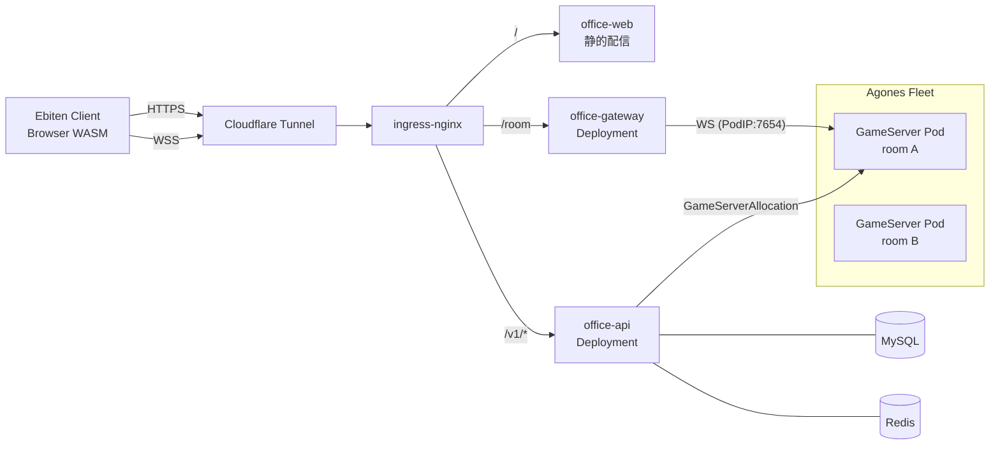
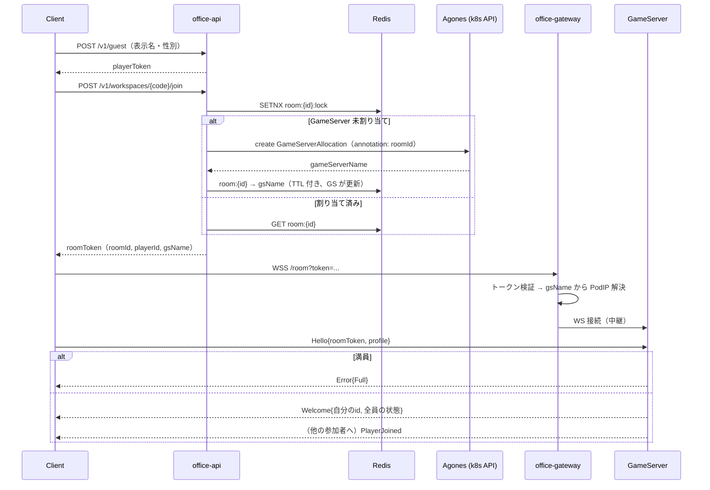

# Gopher Office（仮称）— バーチャルオフィス 設計書

**ステータス:** Draft
**作成日:** 2026-10-21
**関連:** 参考設計 `~/src/ebiten/docs/online-design.md`（Wave Duel オンライン化）、インフラ: `o-ga09/infra`（おうちk3s / ArgoCD）
**最初のマイルストーン:** 2026-11-06 [Ebitengine ぷちConf #5](https://gocon.connpass.com/event/405972/) の LT でデモ

---

## 目次

1. [目的とスコープ](#1-目的とスコープ)
2. [決定事項サマリ](#2-決定事項サマリ)
3. [機能要件（v0）](#3-機能要件v0)
4. [全体アーキテクチャ](#4-全体アーキテクチャ)
5. [ルームと GameServer のライフサイクル](#5-ルームと-gameserver-のライフサイクル)
6. [ネットコード](#6-ネットコード)
7. [ゲーム API サーバ](#7-ゲーム-api-サーバ)
8. [プロフィールとアイコン画像](#8-プロフィールとアイコン画像)
9. [クライアント（Ebitengine WASM）](#9-クライアントebitengine-wasm)
10. [インフラ（おうちk3s）](#10-インフラおうちk3s)
11. [音声・動画通話（LT 後）](#11-音声動画通話lt-後)
12. [リポジトリ構成](#12-リポジトリ構成)
13. [開発フェーズとスケジュール](#13-開発フェーズとスケジュール)
14. [リスク・未決事項](#14-リスク未決事項)

---

## 1. 目的とスコープ

ovice のような 2D バーチャルオフィスを、**Ebitengine（ブラウザ WASM）＋ Agones** で作る。Wave Duel のオンライン化設計と同じく、**ゲーム API サーバ**（永続データ・認証・ルーム割り当て）と**リアルタイムサーバ**（Agones の GameServer）に分ける。

### 当面のゴール

2026-11-06 の LT で、観客がURLを開くだけで同じオフィスに入り、**Gopher が画面を埋め尽くす**デモを動かす。

### v0 のスコープ内

- 招待URLでの入室
- アバター（Gopher）の移動と全員への同期（WASD / クリック移動）
- アバターのカスタマイズ（名前、プロフィールアイコン画像、性別による色）
- 数百体規模の同時表示

### スコープ外（LT 後）

- 音声通話、動画通話（[§11](#11-音声動画通話lt-後)）
- レイアウト編集、複数フロア、複数ワークスペースの切り替え UI
- 永続アカウント（ソーシャルログイン等）
- チャット、近接チャットバブル
- モバイル向けタッチ操作の最適化

---

## 2. 決定事項サマリ

| # | 論点 | 決定 | 主な理由 |
|---|---|---|---|
| D1 | クライアント | **Ebitengine の WASM ビルド** | インストール不要で、招待URLだけで入れる |
| D2 | トランスポート | **WebSocket（TCP）＋ Protocol Buffers** | Cloudflare Tunnel を通せる唯一の実用手段（Wave Duel D3 と同じ） |
| D3 | 外部公開 | Tunnel → ingress-nginx → gateway → GameServer Pod | 自宅IPを公開しない（Wave Duel D4 と同じ） |
| D4 | GameServer の粒度 | **ルーム 1 つ = GameServer 1 つ** | ルームが無人になれば Shutdown でき、スケールの単位が明確 |
| D5 | 権威モデル | サーバ権威（位置・衝突）。移動は「意図」を同期し各クライアントが補間 | 数百人でも帯域を抑えられる（[§6](#6-ネットコード)） |
| D6 | マップ | **固定 1 枚**、オフィス風背景、タイル衝突判定 | v0 の工数を絞る |
| D7 | アバター | **Gopher 固定**。性別で色が決まる（男性＝青、女性＝赤、その他＝黄） | 要望 |
| D8 | 認証 | ゲストログイン（表示名・性別・アイコン） | 永続アカウントは LT 後 |
| D9 | 招待 | `/w/{inviteCode}` の URL がワークスペースを指す。v0 は 1 ワークスペース＝1 ルーム | 複数ルームは構造だけ用意し、UI は後回し |
| D10 | クレジット | **CC BY 3.0 の Gopher クレジットを画面中央に常時表示（Must）** | [§9.3](#93-gopher-クレジット表記must) |
| D11 | 通話（LT 後） | 検証用に **P2P メッシュ（WebRTC 直結）＋自前シグナリング** | まず最小構成で検証。人数上限は割り切る |
| D12 | DB / Redis | 既存クラスタの MySQL / Redis | 新規ミドルウェアを増やさない |
| D14 | API サーバの技術選定 | Web フレームワーク **Echo v5**（`github.com/labstack/echo/v5`）、ORM **GORM**（`gorm.io/gorm` + `gorm.io/driver/mysql`）、バリデーション **go-playground/validator v10** | ユーザー指定 |
| D13 | ドメイン | `*.o-ga09.com`（仮: `office.o-ga09.com`） | 既存 Tunnel 設定を流用 |

---

## 3. 機能要件（v0）

### 入室フロー

1. 招待URL `https://office.o-ga09.com/w/{inviteCode}` を開く
2. 初回のみ**プロフィール設定**: 表示名、性別（男性・女性・その他）、アイコン画像（任意）
3. 入室。マップ上のスポーン位置に Gopher が現れ、既にいる全員が見える

### 移動

- **WASD**: 押している間、その方向へ移動
- **クリック移動**: クリックした地点へ、壁を避けて歩く（経路探索は単純なグリッド A*）
- 壁や家具（衝突タイル）には入れない

### 表示

- 全員を同じ画面に表示する（視界の制限なし）
- Gopher の頭上に**表示名**、横または名前タグ内に**プロフィールアイコン**
- 画面中央に **Gopher クレジット**（常時）

### 性別と色

| 選択 | Gopher の色 |
|---|---|
| 男性 | 青 |
| 女性 | 赤 |
| その他 | 黄 |

### 入室人数の上限

- ルームごとに上限を持つ（既定 200、設定で変更可）。超えたら入室を拒否し「満員」を返す
- 表示名の**文字種は制限しない**。ただし技術的な制約として**長さは最大 32 文字（rune 数）**、制御文字・改行は除去する（描画崩れとログ汚染、帯域を守るため）

---

## 4. 全体アーキテクチャ



Wave Duel との対応:

| Wave Duel | 本プロジェクト | 変更点 |
|---|---|---|
| wave-api | office-api | マッチングが不要になり、ワークスペース・招待・プロフィール・アイコンが加わる |
| wave-gateway | office-gateway | ほぼそのまま。トークンの中身がルーム向けになる |
| wave-gameserver（試合） | office-gameserver（ルーム） | 60Hz の対戦判定ではなく、20Hz の位置同期。短命な試合から長命なルームに変わる |
| `internal/sim` | `internal/sim` | 波の代わりに、マップ・衝突・経路探索・移動。クライアントとサーバで共有 |

### 公開エンドポイント（単一ホスト・パス分け）

| ホスト | パス | 転送先 |
|---|---|---|
| `office.o-ga09.com` | `/` | office-web（`index.html` / `game.wasm` / `wasm_exec.js`） |
| 同上 | `/v1/*` | office-api |
| 同上 | `/room` | office-gateway（WebSocket） |
| `office.home.local` | 同上 | LAN 内確認用 |

---

## 5. ルームと GameServer のライフサイクル

試合型（Wave Duel）との最大の違い。**ルームは長命で、人がいる間だけ GameServer が存在する。** ワークスペースやプロフィールなど永続データは API と DB が持つ。ルーム内の位置は揮発する。



### 実装で確定した方針（P3）

- **Agones SDK**: 公式の Go SDK（gRPC と大きな依存）は使わず、サイドカーの REST API（`localhost:9358`）を `internal/agones` で呼ぶ。`Ready` / `Health`（2 秒ごと）/ `Shutdown` / `watch/gameserver`（annotation の監視）だけ
- **ルームの決まり方**: 割り当て時に API が付ける annotation `roomId` を GameServer が監視で読み、以後その roomId のトークンだけを通す。**割り当て前は、どのトークンも通さない**。無人タイマーも、割り当てられてから数える（待機中に止まらないように）
- **割り当て**: `AgonesAllocator`。Redis には、ロック（`room:{id}:lock`、15 秒）とルーム→GameServer 名（`room:{id}`、1 時間）だけを置く。**生存の確認は、毎回 k8s API で GameServer を取って、`Allocated` かつ annotation が一致するかを見る**（設計時の「GameServer が Redis の TTL を延長する」方式にしないことで、GameServer が Redis を持たずに済む）。`GameServerAllocation` は k8s の集約 API に直接 POST する（allocator の gRPC サービスは使わない）。Ready が無ければ 503
- **ゲートウェイ**: クライアントは `wss://…/room?token=<roomToken>` につなぐ（WebSocket はヘッダを付けられないため URL に載せる。有効 60 秒、ログには URL を出さない）。ゲートウェイは署名と期限を見て、トークンの `gs` から Pod の IP を k8s API で引き（10 秒キャッシュ）、WebSocket を種別のまま中継する。ルームの一致と満員の判定は GameServer が行う（`Hello` のトークンも GameServer で再検証する）
- **client-go は使わない**: `internal/k8s` が ServiceAccount のトークンで REST を呼ぶ。権限は API が `gameserverallocations` の create と `gameservers` の get、ゲートウェイが `pods` の get だけ
- **イメージ**: ルートの `Dockerfile` の `--target`（gameserver / gateway / api / web）。Go のクロスコンパイルで amd64 / arm64 を 1 回のビルドで作る。`main` への push で GHCR に push する（`.github/workflows/images.yml`）

### GameServer の状態遷移

| 状態 | きっかけ |
|---|---|
| Ready | Fleet が事前に待機させている |
| Allocated | 最初の入室要求で API が割り当てる。annotation の `roomId` を読む |
| 稼働中 | 入室・退室を処理し、20Hz で位置をシミュレーション |
| Shutdown | **無人が 5 分続いたら** `SDK.Shutdown()`（Fleet が代わりを補充） |

- 同時に複数人が入室しても割り当てが重複しないよう、API は Redis のロック（`SETNX`、短い TTL）で直列化する
- GameServer は自分の `roomId` と、`Hello` のトークン内 `roomId` が一致しなければ切断する
- 満員判定は GameServer が権威。`Hello` を受けた時点で人数を数え、上限なら `Error{Full}` を返す
- GameServer が落ちた場合、API の `join` は Redis の割り当てが無効（GameServer が存在しない）なら再割り当てする。位置は揮発するので、全員がスポーン位置から入り直す

---

## 6. ネットコード

### 帯域の見積もり（なぜ「意図」を同期するか）

200 人が同じルームにいる場合を考える。

- **毎 tick 全員の座標を全員に送る場合**: 1 人 6 バイト × 200 人 × 20Hz ≈ 24 KB/s を 200 クライアントへ ≈ **4.8 MB/s（約 38 Mbps）**。自宅回線のアップロードでは厳しい
- **移動の意図を送る場合**（本設計）: 位置が変わる**イベントだけ**を送る。各クライアントは受け取った意図から補間して歩かせる
  - 200 体が 5 秒に 1 回行き先を変えるなら、40 イベント/s × 約 16 バイト × 200 宛 ≈ **128 KB/s（約 1 Mbps）**
  - ドリフト補正のため全員の座標を **1Hz で配る**場合でも、1.2 KB × 200 宛 ≈ 240 KB/s（約 2 Mbps）

### 方針

- サーバ tick は **20Hz**（`internal/sim` を共有）
- 時間は整数 tick で進める。`time.Now()` や描画フレームに依存しない
- 移動は**決定的**に計算できる状態で送る: `{位置, 方向 or 目的地}`。クライアントは同じ `internal/sim` で再生する
- クライアントは自分の移動を**先行して表示**（予測）し、サーバの補正に合わせる。他人は受け取った意図から再生して表示する

### 実装で確定した `Moved` と `Sync` の扱い（P2a）

経路は「**その位置からの A\***」で決まるため、移動の**途中**の状態から `MoveTo` で復元すると、現在のタイルの中心へ一度戻る別の経路になり、サーバと軌跡がずれる。そのため次のように役割を分ける。

| メッセージ | 状態をいつ取るか | クライアントの扱い |
|---|---|---|
| `Moved` | コマンドを適用した直後、**Step の前** | その位置・その意図から Actor を作り直す。出発点が同じなので、サーバと同じ軌跡を再生できる |
| `Sync`（1Hz） | 毎 tick の終わり（移動の途中） | 意図が同じなら**経路は保ち、位置のずれが大きいときだけスナップ**（他人 1 タイル超）。意図が違うときだけ作り直す |
| `Sync`（自分） | 同上 | 自分の意図は手元が最新（サーバの状態は往復遅延ぶん古い）なので、**3 タイル超の大きなずれだけ**巻き戻す |

- 他人の再生は、`Moved` の受信遅延と `Sync` の受信遅延が同じ分だけかかるため、通常はずれない
- 自分のずれは往復遅延 × 速度（4 タイル/秒）。RTT 750ms まではスナップしない

### 実測（ローカル、bot 200 体）

- 接続の失敗・エラーは 0。`Moved` は 1 クライアントあたり毎秒約 16 通（tick ごとにまとめるため上限 20）
- `Sync` は 1 人あたり約 28 バイト（プレイヤー ID が文字列のため）。200 人 × 200 クライアント × 1Hz ≈ 1.1 MB/s（**約 9 Mbps**）で、上の見積もり（約 2 Mbps）より大きい
- **P4 で削った**（下の「実測（P4）」）: ① プレイヤー ID をルームごとの数値（uint32 の `pid`）にする ② `Sync` から静止中のプレイヤーを省く ③ `Sync` を人数に応じて間引く

### 実測（P4）

`make loadtest`（bot が 3〜8 秒ごとに行き先を変えて歩く）。GameServer の送信帯域と、tick の処理時間（予算 50 ms）。

| | 帯域（200 体） | tick 平均 |
|---|---|---|
| P2a の実装 | 11.7 Mbps | 1.4 ms |
| ① `pid`（文字列 ID の 26 バイトを 1〜3 バイトに）、方向を `sint32` に | ②と合わせて計測 | — |
| ② 静止中を `Sync` から省く（止まった直後に 1 回だけ載せ、全員が止まっていれば `Sync` 自体を送らない） | 5.2 Mbps | 1.1 ms |
| ③ `Sync` の間隔を、100 人ごとに 1 秒延ばす | **3.2 Mbps** | 1.3 ms |

- 400 体（上限を 600 に上げて）でも 8.0 Mbps、tick 1.0 ms。**制約は CPU ではなく上り回線**
- 切断・追い出し・捨てたメッセージ・tick の超過は 0
- `pid` は、入室のたびに 1 ずつ増やすルーム内の番号で、再利用しない。クライアントは `Welcome` / `PlayerJoined` で `pid` を知り、以後の `Moved` / `Sync` / `PlayerLeft` はすべて `pid` で指す
- `Sync` の間引きは、再生のずれを直す保険の頻度を下げるだけ（`Moved` は変わらない）。ずれは決定的な再生なので普通は起きない
- 計測値: GameServer は `/metrics`（Prometheus 形式。Ingress には出さない）と、10 秒ごとの `stats` ログ（人数・送信 Mbps・tick 平均・超過・捨てた数・追い出し数）を出す

### メッセージ（Protocol Buffers、WebSocket バイナリフレーム）

| 方向 | メッセージ | 頻度 | 内容 |
|---|---|---|---|
| C→S | `Hello` | 接続時 | roomToken、クライアントバージョン、プロフィール（表示名・性別・アイコンID） |
| C→S | `MoveTo` | クリック時 | 目的地（タイル座標） |
| C→S | `MoveDir` | 入力が変わった時 | 方向（8方向＋停止）。押しっぱなしで毎フレーム送らない |
| C→S | `Ping` | 1Hz | クライアント時刻（RTT 計測、Cloudflare の 100 秒アイドル対策） |
| S→C | `Welcome` | 接続時 | 自分の `playerId`、マップID、サーバ tick、全員の現在状態 |
| S→C | `PlayerJoined` / `PlayerLeft` | 即時 | プロフィール、スポーン位置 |
| S→C | `Moved` | 即時（変化時） | 意図が変わった人の `MoveState`（位置、方向、目的地）。Step の前の状態。tick ごとにまとめる |
| S→C | `Sync` | 1Hz | 全員の `MoveState`。ドリフト補正用（[実装で確定した扱い](#実装で確定した-moved-と-sync-の扱いp2a)） |
| S→C | `Pong` | 1Hz | エコー＋サーバ tick |
| S→C | `Error` | 即時 | `Full`, `BadToken` など |

- 座標はサブユニット（1 タイル = 256）の整数で持つ。`proto` の `int32`（varint）で送る
- `Moved` はブロードキャスト時に同一 tick のものをまとめて 1 フレームで送る
- 入力は接続あたり 60 メッセージ/秒（バースト 120）に制限し、超えたら `RATE_LIMITED` で切断する。1 フレームの上限は 4 KB
- WebSocket ライブラリは WASM でも動く `github.com/coder/websocket`

### サーバ側の最適化

- ブロードキャストは各接続ごとの送信キュー（バッファ付き goroutine）。遅いクライアントのキューが溢れたら**古い `Sync` を捨てる**（`Moved` は捨てない）
- シミュレーションと送信は分離し、1 ルーム 1 goroutine がシミュレーションを持つ（ロック競合を避ける）

---

## 7. ゲーム API サーバ

### 技術スタック

| 用途 | 採用 | 備考 |
|---|---|---|
| Web フレームワーク | Echo v5（`github.com/labstack/echo/v5`） | v4 とは import パスと API が異なる（ハンドラの引数など）。実装時に v5 のドキュメントで確認する |
| ORM | GORM（`gorm.io/gorm`、`gorm.io/driver/mysql`） | 下記のデータモデルは GORM のモデルとして定義する |
| バリデーション | go-playground/validator v10 | リクエスト DTO の struct タグで検証する |

- **バリデーションの適用範囲**: 表示名は 1〜32 文字（rune 数。`validate:"required,min=1,max=32"` は文字数で数えられる）、性別は 0〜2、招待コードは英数字 12 文字程度。制御文字の除去は validator ではなく入力の正規化で行う
- **マイグレーション**: GORM の `AutoMigrate` は使わない（起動のたびにスキーマを書き換えると、Fleet や複数レプリカと相性が悪い）。SQL は `internal/migrate/sql/` に置いてバイナリに埋め込み、`cmd/migrate`（`migration-job.yaml`、コンテナ名 `migration`）で 1 回だけ適用する。MySQL の `GET_LOCK` で同時実行を直列化し、適用済みのバージョンは `schema_migrations` に記録する
- **画像アップロード**: `PUT /v1/me/icon` は Echo のボディサイズ制限（256 KB）をミドルウェアで掛ける（P2c）
- **認証**: playerToken は、ルートごとに付けたミドルウェア（`requireAuth`）で検証して `playerId` をコンテキストに載せる。グループにまとめて付けると、存在しないパスにも認証が掛かって 404 が 401 になるため。`/internal/*` は別ミドルウェアで internalToken を検証する

### 実装で確定した API の方針（P2b）

- **エラーの形**: `{"error": {"code": "...", "message": "...", "fields": {...}}}`。想定外のエラー（DB のエラーなど）の詳細は、クライアントには返さずログにだけ残す。バリデーションエラーは JSON のフィールド名で返す
- **入力の制限**: ボディは 8 KB まで。表示名は、正規化の前の入力を 256 文字までとし、正規化（制御文字・BiDi・ゼロ幅文字の除去、32 文字）して保存する
- **レート制限**: ゲスト作成は IP ごとに 20 回/分、ワークスペース作成・入室はプレイヤーごとに 60 回/分。Cloudflare Tunnel の背後では、`-trust-cloudflare-ip` で `CF-Connecting-IP` を使う（API に Cloudflare を通らず届かない場合だけ。偽装できてしまうため既定は無効）。1 人が作れるワークスペースは 5 つまで
- **招待コード**: 暗号論的乱数の base62・12 文字（約 71 ビット）。存在しないコードと形式の違うコードは、どちらも同じ 404 を返す。ログには URI ではなくルートのパターンを記録し、招待コードを残さない
- **CORS**: 既定は無効（本番は同一オリジン）。開発でブラウザ版と API のオリジンが違うときだけ `-cors-origin` で許可する。ワイルドカードは使わない
- **ルームの割り当て**: `RoomAllocator` インターフェースで抽象化し、P2b は固定の GameServer を返す `StaticAllocator`。Agones の `GameServerAllocation` は P3 で追加する
- **運用コマンド**: `cmd/ctl` がワークスペースを作って招待 URL を表示する（ワークスペース作成の UI は P6）

### エンドポイント

| メソッド | パス | 説明 |
|---|---|---|
| `POST` | `/v1/guest` | ゲスト作成（表示名・性別）。`playerToken`（HS256、30 日）を返す |
| `PATCH` | `/v1/me` | 表示名・性別を変更 |
| `GET` | `/v1/me` | 自分のプロフィール |
| `PUT` | `/v1/me/icon` | アイコン画像のアップロード（[§8](#8-プロフィールとアイコン画像)） |
| `GET` | `/v1/players/{id}/icon` | アイコン画像の取得（キャッシュ可） |
| `POST` | `/v1/workspaces` | ワークスペース作成。`inviteCode` を返す |
| `GET` | `/v1/workspaces/by-code/{code}` | 招待コードからワークスペース情報を取得 |
| `POST` | `/v1/workspaces/{code}/join` | 入室。`roomToken` を返す（必要なら GameServer を割り当てる） |
| `POST` | `/internal/rooms/{id}/closed` | GameServer からの閉鎖通知（内部トークン認証、Ingress には出さない） |
| `GET` | `/healthz` | ヘルスチェック |

### データモデル（MySQL）

実際の DDL は `internal/migrate/sql/` にある（下はその要点）。GORM のモデルは `internal/api/model.go`。

```sql
CREATE TABLE players (
  id            CHAR(26)     PRIMARY KEY,        -- ULID
  display_name  VARCHAR(128) NOT NULL,           -- 32 rune 以内。バイト余裕を持たせる
  gender        TINYINT UNSIGNED NOT NULL,       -- 0=男性(青) 1=女性(赤) 2=その他(黄)
  icon_hash     CHAR(64)     NULL,               -- アイコン画像の SHA-256
  created_at    DATETIME(3)  NOT NULL
);

CREATE TABLE player_icons (
  hash       CHAR(64)    PRIMARY KEY,            -- 再エンコード後の画像の SHA-256
  data       MEDIUMBLOB  NOT NULL,               -- 64x64 PNG
  created_at DATETIME(3) NOT NULL
);

CREATE TABLE workspaces (
  id           CHAR(26)    PRIMARY KEY,
  owner_id     CHAR(26)    NOT NULL REFERENCES players (id),   -- 1 人あたりの作成数の制限に使う
  name         VARCHAR(64) NOT NULL,
  -- 照合順序は ascii_bin（大文字と小文字を区別する）。ci だと、大文字小文字だけが違う別のコードが衝突する
  invite_code  VARCHAR(16) CHARACTER SET ascii COLLATE ascii_bin NOT NULL UNIQUE,
  max_players  INT         NOT NULL DEFAULT 200,
  created_at   DATETIME(3) NOT NULL
);

CREATE TABLE rooms (
  id            CHAR(26)    PRIMARY KEY,
  workspace_id  CHAR(26)    NOT NULL REFERENCES workspaces (id),
  name          VARCHAR(64) NOT NULL,
  map_id        VARCHAR(32) NOT NULL DEFAULT 'office-1'
);
```

v0 では「ワークスペース作成時にルームを 1 つ自動作成」する（同じトランザクションで作る）。`player_icons`（`0002_player_icons.sql`）は P2c で追加した。

### Redis

| キー | 用途 |
|---|---|
| `room:{id}:lock` | GameServer 割り当ての直列化（短 TTL） |
| `room:{id}` | `gsName`。GameServer が定期的に TTL を延長する（生存確認を兼ねる） |

### トークン

| 種類 | 用途 | 中身 | 有効期限 |
|---|---|---|---|
| playerToken | API 認証 | `sub=playerId`、`aud=player` | 30 日 |
| roomToken | ゲートウェイ / GameServer への入室 | `sub=playerId`、`room`（roomId）、`gs`（gsName）、`aud=room` | 60 秒 |
| internalToken | GameServer → API | 固定の共有シークレット | — |

- 署名は HS256。検証では、アルゴリズムの固定、`iss`・`aud`・`exp` の必須チェックを行い、`alg=none` や有効期限なしのトークンは通さない
- **鍵は用途ごとに分ける**。playerToken の鍵は API だけが持ち、roomToken の鍵を API・ゲートウェイ・GameServer が共有する。GameServer の鍵が漏れても、playerToken は偽造できない（`aud` でも用途を分け、playerToken を roomToken として使い回せない）
- GameServer 上のプレイヤー ID は、roomToken の `sub`（API のプレイヤー ID）になる。クライアントが名前を偽って別人になることはできない
- GameServer は自分が担当するルームの ID と、トークンの `room` が一致しなければ拒否する
- 鍵は環境変数（`PLAYER_TOKEN_SECRET`、`ROOM_TOKEN_SECRET`）で渡し、フラグでは渡さない。32 バイト未満の鍵と、2 つの鍵が同じ値の起動は拒否する。本番は SealedSecret で配布する

招待コードは 12 文字の base62 乱数（約 71 ビット）とし、推測不能にする。

---

## 8. プロフィールとアイコン画像

アップロード画像は**プロフィールアイコン専用**。Gopher の体には貼らない（体は常に Gopher）。

### アップロード処理（`PUT /v1/me/icon`）

1. リクエストサイズを **256 KB 以下**に制限する
2. `Content-Type` ではなく**中身から画像形式を判定**する（PNG / JPEG / WebP のみ許可）
3. デコードし、寸法上限（例: 4096×4096）を超えるものは拒否する（decompression bomb 対策）
4. **64×64 に縮小して PNG に再エンコード**する（EXIF などのメタデータが除去される）
5. SHA-256 を計算し、`player_icons` に保存する（同一内容は重複保存しない）。`players.icon_hash` を更新する

### 配信

- `GET /v1/players/{id}/icon` は `ETag` に `icon_hash` を使い、`Cache-Control` を付ける。Cloudflare 側でキャッシュできる
- GameServer の `Welcome` / `PlayerJoined` には**画像そのものではなく `icon_hash` だけ**を載せる。クライアントが必要に応じて取得し、メモリにキャッシュする
- 数百人が一斉に入るとアイコン取得が集中するため、取得は並列数を制限し、未取得の間は Gopher のシルエットを表示する

### 実装で確定した方針（P2c）

- **アップロード**: `PUT /v1/me/icon` のボディは画像のバイト列そのもの（multipart ではない）。`Content-Type` は見ない。JSON の 8 KB 制限はこのルートだけ 256 KB に緩める。エラーは 413 `too_large`、400 `image_dimensions`、415 `unsupported_image`
- **配信**: `GET /v1/players/{id}/icon` は認証不要。`ETag` は `"<icon_hash>"`。クエリ `?h=<icon_hash>` が現在のハッシュと一致すれば `immutable`（1 年）、それ以外は `no-cache`（ETag で再検証）。クライアントは常に `?h=` を付ける
- **クライアント**: 取得した画像の SHA-256 が `icon_hash` と一致しなければ捨てる。取得の並列数は 4。取得中は人のシルエットを表示する。GameServer は形式（小文字 16 進 64 文字）の違う `icon_hash` を空にする
- **ブラウザ版の画像選択**: ブラウザ側で中央を正方形に切り出し、一辺 256px 以下の PNG にしてから送る（スマホの写真が 256 KB を超えても使えるように）。デスクトップ版はアイコンを設定できない（ファイル I/O をしない方針）
- **未対応**: 使われなくなった `player_icons` の行は消さない（LT 後に GC か、オブジェクトストレージ化）

### ストレージ

v0 は MySQL の BLOB（64×64 PNG は数 KB）。件数が増えたら S3 互換ストレージ（MinIO 等）に移す。

### 表示名の描画

- 表示名の文字種は制限しないが、**フォントに含まれない字は豆腐（□）になる**。日本語を含められるよう Noto Sans JP などの日本語対応フォントを同梱する（サイズ対策としてサブセット化を検討）
- 絵文字はカラー描画が難しいため、v0 では非対応（豆腐表示を許容）。必要になったら絵文字用の画像アトラスを用意する

---

## 9. クライアント（Ebitengine WASM）

### 9.1 描画

- **背景**: オフィス風のマップ画像（タイルマップ＋装飾）を 1 枚の `*ebiten.Image` に事前合成して描画する
- **Gopher**: 青・赤・黄の 3 色分のスプライト（4 方向の歩行アニメーションを想定）。同じ画像を連続で描くと Ebitengine が自動でバッチ化するため、**色ごとにまとめて描画順を整える**（数百体でも `DrawImage` の呼び出しコストが支配的にならないように）
- **名前タグ**: 文字描画は重い。表示名ごとに描画結果をキャッシュ（`*ebiten.Image`）し、毎フレームの `text` 呼び出しを避ける
- **深度順**: y 座標でソートして奥から手前に描く
- 数百体の画面になるため、LOD として「画面が混雑したら名前タグを省略する」切り替えも用意しておく

### 9.2 入力

- キーボード: `W` `A` `S` `D`（`MoveDir`）
- マウス / タッチ: クリックした画面座標をタイル座標に変換して `MoveTo`
- ブラウザの裏タブでは `requestAnimationFrame` が止まる。復帰時は `Welcome` 相当の状態再取得（または `Sync` 待ち）で合わせ直す

### 9.3 Gopher クレジット表記（Must）

Gopher は Renée French さんのデザインで、**CC BY 3.0** ライセンス。色を変える改変を加えるため、改変の旨も明示する。

- **画面中央に常時表示する**（入室前の画面・入室後のマップ上とも。閉じる操作は設けない）
- 表記内容（案）:
  > The Go gopher was designed by Renée French. Licensed under CC BY 3.0 — modified (recolored).
  > https://creativecommons.org/licenses/by/3.0/
- 描画は **最後（最前面）** に行い、アバターや UI に隠れないようにする。視認性のため半透明の背景を付けてもよい（透明度の調整は可、非表示は不可）
- LT のスライドにも同様に、スライドの中央に表記する
- 受け入れ条件: スクリーンショット（入室前・入室後・全員が密集した状態）のすべてで、読める状態で中央にクレジットが見えること

### 9.4 WASM 固有の注意

- `os/exec`、ファイルI/O、生のTCP/UDPソケットをクライアントで使わない（WASM 非対応）
- `game.wasm` は十数 MB になる。gzip / brotli 配信と、読み込み中の表示を入れる
- 変更後は `GOOS=js GOARCH=wasm go build ./cmd/client` が通ることを確認する

---

## 10. インフラ（おうちk3s）

### 前提の確認

`~/src/infra` を確認した時点では **Agones のマニフェストは未導入**（`agones` を含むファイルなし）。Wave Duel の設計書（P3）にも導入予定として書かれているため、**Agones 本体は両プロジェクトで共用**する。Helm values の `gameservers.namespaces` に `wave-duel` と `gopher-office` の両方を指定する。

導入時の注意は Wave Duel の設計書 §9 と同じ:

- ArgoCD Application に `syncOptions: [ServerSideApply=true]`
- k3s のバージョンと Agones の対応 Kubernetes バージョンを事前に照合する
- ノードのアーキテクチャ（amd64 / arm64）を確認し、イメージは multi-arch でビルドする
- 2 ノードの空きリソースを確認する。allocator と ping は使わないので無効化してよい

### 追加するもの

```
apps/
└── gopher-office.yaml
manifests/gopher-office/
├── namespace.yaml
├── fleet.yaml               # Fleet + FleetAutoscaler（containerPort 7654、portPolicy: None）
├── api-deployment.yaml      # container name: office-api
├── api-service.yaml
├── gateway-deployment.yaml  # container name: office-gateway
├── gateway-service.yaml
├── web-deployment.yaml      # container name: office-web
├── rbac.yaml                # api: allocation create / gateway: gameservers get
├── ingress.yaml             # office.o-ga09.com, office.home.local
├── migration-job.yaml       # container name: migration
├── servicemonitor.yaml
└── sealed-secret.yaml
```

- **Fleet**: 常時 1〜2 台を待機させる（`FleetAutoscaler` の Buffer）。上限は小さめに設定する
- **GameServer のリソース**: 200 体のブロードキャストを処理するため、Wave Duel より余裕を持たせる（目安: request `cpu: 200m / memory: 128Mi`、limit `cpu: 1 / memory: 256Mi`。負荷テストで調整）
- **ingress-nginx**: WebSocket 用に `proxy-read-timeout` / `proxy-send-timeout` を 3600 に設定する
- **Cloudflare Tunnel**: Public Hostname に `office.o-ga09.com` → ingress-nginx を追加する

### 注意

`o-ga09/infra` は **main への push が即本番反映**されるため、push 前にユーザーへ確認する。

### 可観測性

- ログ: 標準出力に JSON
- メトリクス: `/metrics`（ServiceMonitor）。接続数、ルーム内人数、tick 処理時間、ブロードキャスト送信バイト数、送信キュー溢れの回数
- 負荷テスト時の帯域確認のため、ルーム内人数と送信バイトのダッシュボードを用意する

---

## 11. 音声・動画通話（LT 後）

### 制約

WebRTC のメディアは UDP（または TCP/TLS の TURN）を使う。**Cloudflare Tunnel は UDP を通せない**ため、メディアを自宅の k3s に流す構成（SFU など）は別経路が必要になる。そこで検証段階は **P2P メッシュ**にする。

### 構成（検証用）

- ブラウザ同士が WebRTC で直接つなぐ。メディアは自宅回線を通らない
- **シグナリング**（SDP / ICE の交換）は既存の GameServer の WebSocket に載せる。`Signal{to, payload}` を GameServer が宛先へ中継するだけ
- STUN は公開のものを使用。NAT 越えに失敗する環境向けの TURN は後回し
- **人数は 4〜6 人程度に限定**する（メッシュは接続数が人数の二乗で増える）。実際に聞こえる範囲を距離で絞る**近接音声**にすれば、同時接続数を抑えられる

### 実装方針

- 通話は**ブラウザ標準の WebRTC**に任せる。Ebitengine（Go/WASM）からは `syscall/js` で、`index.html` に置いた JS の薄いラッパー（`getUserMedia`、`RTCPeerConnection`、`GainNode`）を呼ぶ
- 音量は Gopher 間の距離に応じて `GainNode` で調整する（一定距離外は 0）
- 動画は Ebitengine の canvas への取り込みが重いため、最初は **DOM オーバーレイ**（`<video>` を canvas の上に重ねる）で表示する
- 音声から先に作り、動画はその後に追加する

### 実装で確定した方針（P5 第 1 弾：音声）

- **opt-in**: 通話は既定でオフ。`V` キーを押したときだけマイクの許可を求める。`M` でミュート
- **シグナリング**: `Signal{pid, payload}` を GameServer がそのまま宛先へ中継する（payload は JSON の SDP / ICE で最大 6000 バイト。超えると `BAD_REQUEST`）。宛先がいない・自分宛て・送信キューが溢れているときは捨てる（追い出さない）。プロトコル版を `3` に上げた
- **つなぐ相手**: 近い順に最大 5 人（`MaxPeers`）、8 タイル以内（`HearRadius`）。いったんつないだ相手は 10 タイル（`DropRadius`）まで切らない。0.5 秒ごとに見直す。上限に達しているとき、後から来た近い人のために既存の接続を切ることはしない
- **音量**: 2 タイル以内は 1、8 タイルで 0 の直線減衰（`internal/voice` の `Gain`）。`GainNode` に `setTargetAtTime` で反映する
- **offer を作る側**: pid の小さい側（衝突の回避）。先に相手の offer が届いたときは、近くにいれば応答する側として受け入れる
- **失敗**: 接続の失敗・15 秒のタイムアウトは Go に通知し、5 秒待ってから再度つなぐ
- **構成**: ロジック（計画・シグナリングの振り分け）は `internal/voice`（ブラウザ非依存、テストあり）、WebRTC は `web/voice.js`、橋渡しは `cmd/client/voice_js.go`（`voice.Engine` の実装）。STUN は公開のもの、TURN は未対応（対称 NAT の相手とは通話できない）
- 動画は未着手（次の弾）

### 将来の本命構成（メモ）

人数を増やすなら SFU が必要。候補: LiveKit の自前運用、Cloudflare Realtime SFU / TURN。UDP の経路をどう確保するか（ルーターのポート開放 / VPS リレー / マネージド SFU）は、その時点で ADR を起こして決める。

---

## 12. リポジトリ構成

リポジトリ名は仮。現在のワークスペース `~/src/ebiten-workspace` は未 git 管理で、Git 化とリポジトリ名は別途決める。

```
cmd/
├── client/main.go        # Ebiten クライアント（ブラウザ WASM / デスクトップ）
├── gameserver/main.go    # -local フラグで Agones SDK をスキップ
├── gateway/main.go
├── api/main.go
└── bot/main.go           # 負荷テスト用の疑似クライアント（ランダムに歩く）
internal/
├── sim/                  # ebiten 非依存。マップ・衝突・経路探索・移動。★最優先でテスト
├── client/               # 描画・入力・画面遷移（sim を使う）
├── netcode/              # 補間・時刻同期（クライアント側）
├── gameserver/
├── gateway/
└── api/
proto/office/v1/          # メッセージ定義
web/                      # index.html（game.wasm / wasm_exec.js は生成物）
assets/                   # マップ画像、Gopher スプライト、フォント
deploy/local/             # kind/k3d + Agones のローカル検証用（任意）
Dockerfile.*              # 各バイナリ用（distroless / multi-arch）
docs/
```

- `sim` はサーバとクライアントで共有する。時間は整数 tick、乱数はシード付き
- `cmd/bot` は同じ `proto` を使い、WebSocket で入室して歩き回る。「Gopher で埋め尽くす」デモと負荷テストの両方に使う
- 素材（Gopher の画像）の出典とライセンスを `assets/README.md` に記録する

---

## 13. 開発フェーズとスケジュール

2026-11-06 の LT まで約 2 週間。**LT 前（P1〜P4）は、デモに必要なものだけを作る。**

| Phase | 期間（目安） | 内容 | 完了条件 |
|---|---|---|---|
| **P1** | 10/21〜10/26 | `internal/sim`（マップ・衝突・A*・移動）、Gopher 3 色、背景、クレジット表示、ローカルで 1 クライアントが歩ける | ブラウザで WASD とクリック移動ができ、壁を抜けない。クレジットが中央に出ている。sim のテストが通る |
| **P2** | 10/24〜10/30 | proto 定義、`cmd/gameserver`（`-local`）、クライアントのオンライン接続、`cmd/bot`、招待URL入室（API の最小実装：guest / workspace / join） | localhost で 2 つのブラウザと bot 200 体が同じルームに入り、全員が見える。表示名・性別・アイコンが反映される |
| **P3** | 10/29〜11/3 | infra に Agones 導入と Fleet、SDK 組み込み、`cmd/gateway`、Tunnel 公開、`office.o-ga09.com` で動作 | 外部ネットワークのブラウザから招待URLで入れる。無人 5 分で GameServer が Shutdown する |
| **P4** | 11/3〜11/5 | 200 体の負荷試験（帯域・tick 時間）、上限調整、**事前録画**、スライド作成、リハーサル | 本番想定の人数でデモが破綻しない。録画が完成している |
| **LT 当日** | 11/6 19:00〜 | 発表（5〜10 分） | — |
| **P5（LT 後）** | — | P2P 音声通話、近接音声、その後に動画 | [§11](#11-音声動画通話lt-後) |
| **P6（LT 後）** | — | 複数ルーム・複数ワークスペースの UI、永続アカウント、アイコンのオブジェクトストレージ化 | — |

### クリティカルパスと保険

- **最大のリスクは Agones の導入**（クラスタとの相性が未確認、infra に前例がない）。P3 で詰まった場合の保険として、**Agones なしで GameServer を通常の Deployment として動かす構成**（`-local` のまま、ルームは固定の 1 つ）を用意しておく。LT では Agones の構成を図で説明し、実演は保険構成でも成立させる
- 会場の回線が不安定な場合に備え、**事前録画**を用意する（ユーザー確認済みの方針）
- 負荷が不安な場合は、観客参加の上限を下げる（上限は設定で変更可能にしておく）

### LT のストーリー案

1. 何を作ったか（Gopher で埋まるバーチャルオフィス）を見せる
2. Ebitengine WASM と Go のサーバで、`internal/sim` をクライアント・サーバで共有している点
3. ゲームサーバ構成（API とリアルタイムサーバ、Agones）の図
4. 観客にURLを共有して入ってもらう（デモ）
5. 今後（音声通話）

---

## 14. リスク・未決事項

| 項目 | 内容 | 対応 |
|---|---|---|
| Agones の導入 | 未導入。k3s のバージョン・アーキテクチャ・リソースが未確認 | P3 着手前に `kubectl get nodes -o wide` 等で確認。保険構成を用意する |
| 数百人の同期 | 帯域と tick 時間が上限に当たる可能性 | 意図の同期＋1Hz の Sync で見積もり済み。`cmd/bot` で P4 前に早期計測する |
| WASM の描画性能 | 数百体の描画と名前タグで重くなる可能性 | バッチ描画、名前タグのキャッシュ、混雑時の LOD。早めに 200 体で FPS を計測する |
| 会場回線・自宅回線 | 自宅のアップロード帯域がボトルネックになりうる | 事前録画を保険にする。観客の人数を絞る |
| 表示名の自由さ | 文字種を制限しないため、不適切な表示名・画像が出る可能性 | デモ中は招待URLを限定して配る。長さ・制御文字だけ技術的に制限。LT 後に通報・キック機能を検討 |
| アイコン画像 | 不適切画像・巨大画像・細工された画像 | サイズ上限、寸法上限、再エンコード（[§8](#8-プロフィールとアイコン画像)）。モデレーションは LT 後 |
| フォントの字種 | 全字種を許可しても、フォントに無い字は豆腐になる | 日本語フォントを同梱。絵文字は v0 非対応 |
| Gopher のクレジット | 表記漏れはライセンス違反 | Must として受け入れ条件に入れる（[§9.3](#93-gopher-クレジット表記must)）。スライドにも入れる |
| Gopher の素材 | 青・赤・黄の素材を用意する必要がある | 既存 Gopher 画像の色違い加工、または自作。出典とライセンスを記録する |
| Cloudflare の遅延 | 自宅 → Cloudflare → 自宅の往復で数十 ms が加算される | 移動はゲーム性が低く、補間で吸収できる |
| 通話（LT 後） | UDP が Tunnel を通らない。P2P は人数に限界がある | [§11](#11-音声動画通話lt-後)。SFU の経路確保は別 ADR |
| 単一レプリカの API | 割り当ての直列化は Redis ロックで行うが、他は単一前提 | 当面許容 |
| `o-ga09/infra` の push | main への push が即本番反映される | push 前に必ずユーザーに確認する |
